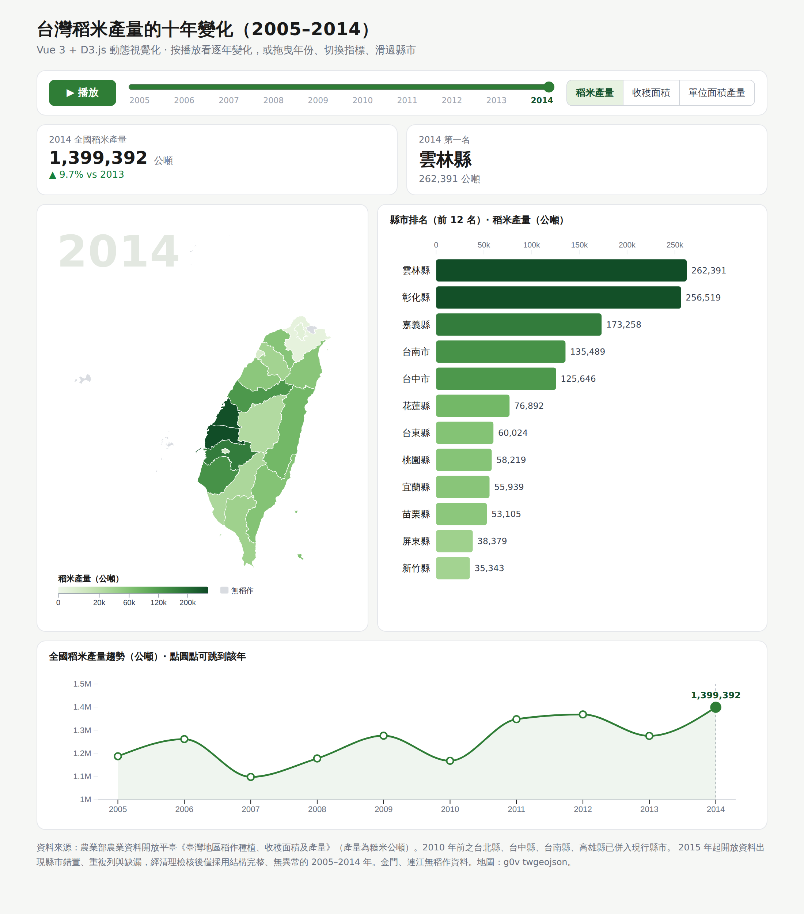
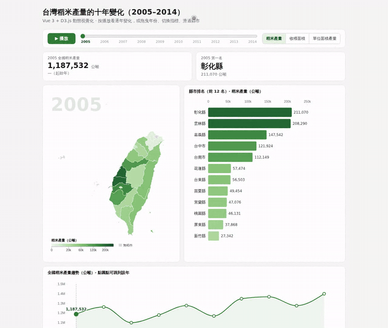

# 1151VIS-HW2｜台灣稻米產量的十年變化（Vue 3 + D3.js 動態視覺化）

資料分析與視覺化應用 HW2：Dynamic visualization using D3.js。延續 HW1 的稻米主題，把「一年的靜態地圖」擴充成 **2005–2014 年的動態視覺化**：按下播放，地圖顏色、縣市排名與全國趨勢會逐年一起變化。

- **GitHub**：https://github.com/Duncan8805/1151VIS-HW2-414085210-TsengChenYu
- **YouTube 互動影片**：（上傳後填入連結）

## 專案截圖



### 動態示範



## 動態與互動功能

| 功能 | 操作 | D3 技術 |
|---|---|---|
| 逐年播放 | 按「▶ 播放」，每 1.3 秒前進一年 | 三張圖同時 `transition()` |
| 年份滑桿 | 拖曳滑桿跳到任一年 | 同上 |
| 指標切換 | 稻米產量／收穫面積／單位面積產量 | 色階、圖例、座標軸一起 transition |
| 動態地圖 | 縣市顏色隨年份平滑漸變，左上角大字顯示年份 | `attr('fill')` transition、`d3.scaleSequentialSqrt` |
| 排名長條圖 | bar chart race：名次交換、長度與數字同步動畫 | 以縣市為 key 的 data join、enter/update/exit、`tween` 數字補間 |
| 全國趨勢折線 | 游標跟著年份移動；點圓點可跳到該年；載入時折線由左畫到右 | path transition、`stroke-dashoffset` 動畫 |
| 聯動 hover | 滑過地圖或長條圖，兩邊同步高亮，tooltip 顯示數值、名次與年增減 | Vue 共用狀態 + D3 `classed()` |
| KPI 卡片 | 當年全國數值與 ▲▼ 年增率、第一名縣市 | Vue `computed` |

## 參考的 D3 Graph Gallery 範例

- Barplot：[Change input data – upgraded version](https://d3-graph-gallery.com/graph/barplot_button_data_hard.html)（切換資料時長條與軸 transition）
- Barplot：[Animation at loading](https://d3-graph-gallery.com/graph/barplot_animation_start.html)（長條從 0 長出來）
- Line chart：[Transition between input data](https://d3-graph-gallery.com/graph/line_change_data.html)（切換指標時折線變形）
- Line chart：[Add cursor for exact value](https://d3-graph-gallery.com/graph/line_cursor.html)（年份游標）
- [Choropleth map](https://d3-graph-gallery.com/choropleth.html)（分級著色地圖）

在範例的基礎上，改成 Vue 元件化、三張圖共用同一個年份／指標狀態，並把長條圖改成依名次重新排序的 bar chart race。

## 技術架構

- **Vue 3**（`<script setup>`）負責狀態：年份、指標、播放、hover 縣市
- **D3.js v7** 負責繪圖與動畫：`d3-geo`（投影）、`d3-scale`（色階、座標）、`d3-selection` / `d3-transition`（data join 與動畫）
- 分工原則：**Vue 管「現在是哪一年、哪個指標」，D3 管「畫面怎麼變過去」**。每個元件用 `watch(props)` 偵測變化後呼叫 D3 transition。

```
src/
├── App.vue                    # 狀態、播放控制、KPI、tooltip、版面
├── components/
│   ├── TaiwanMap.vue          # 動態 choropleth + 連續色階圖例
│   ├── RankBars.vue           # 縣市排名 bar chart race
│   └── TrendLine.vue          # 全國趨勢折線 + 年份游標
└── data/
    ├── riceSeries.json        # 清理後的 2005–2014 各縣市產量與面積
    ├── metrics.js             # 指標計算、排名、共用比例尺
    └── taiwan-counties.json   # 縣市界 GeoJSON（沿用 HW1）
```

## 執行方式

```bash
npm install
npm run dev       # http://localhost:5173
npm run build     # 打包到 dist/
```

## 資料來源與清理流程

**來源**：農業部農業資料開放平臺《臺灣地區稻作種植、收穫面積及產量》（2005–2024，2,132 筆；產量為糙米公噸）。

1. **下載**：從開放平臺匯出完整 CSV。
2. **縣市合併**：2010 年底縣市合併前的台北縣、台中縣、台南縣、高雄縣分別併入新北市、台中市、台南市、高雄市；「桃園市／桃園縣」統一為地圖用的名稱。
3. **加總**：同一年同一縣市的各稻作品項（蓬萊、在來、長秈、長糯、圓糯）加總成總產量與總收穫面積。
4. **品質檢核**（這一步發現大量問題）：
   - **2019**：新北市出現 132 萬公噸（實為全國蓬萊稻合計被誤植）；多個縣市有「標籤不同、數值完全相同」的重複列。
   - **2018**：全國總量只有約 106 萬公噸，遠低於官方公布的約 156 萬，資料不完整。
   - **2015–2016**：台中市少了約 9 萬公噸、高雄市卻多了約 9 萬，兩縣市資料錯置（全國總量不受影響）。
   - **2005–2014**：每縣市每年剛好 5 列、無重複，逐年序列也沒有異常跳動（以各縣市中位數 ±40–50% 掃描）。
   - 另外，同一資料集的 2015、2017 全國總量與官方公布值完全一致，雲林、南投、嘉義縣、台南、苗栗等縣市的官方數值也逐一吻合，代表資料來源可信、錯誤集中在個別年份的特定列。
5. **結論**：只採用乾淨的 **2005–2014 年**（10 年 × 20 縣市），2015 年以後不納入。

## 從動態圖看到的現象

- **米倉在中部**：雲林縣與彰化縣十年來輪流拿第一，兩縣合計占全國的 35–41%。
- **2010 年南部明顯下滑**：台南市（▼38.5%）、嘉義縣（▼24.8%）同時大跌，全國當年減少 8.5%。2010 年 9 月凡那比颱風從台南七股出海，台南、嘉義出現 11–12 級陣風，全台農漁業損失逾 34 億元，可能是原因之一（資料未細分稻作災損，屬推測）。
- **單位面積產量**：切換到「單位面積產量」後排名大洗牌：屏東縣總產量只排第 11 左右，單產卻幾乎年年前三；雲林則是總產量和單產都名列前茅。

## 遇到的問題與解法

- **開放資料錯誤**：一開始直接加總就出現「新北市產量全國第一」的荒謬結果，才回頭逐年檢查列數、找重複列、與官方數值比對，最後決定縮小年份範圍，而不是硬修資料。
- **平方根色階的圖例刻度擠在一起**：只保留間距 ≥ 40px 的刻度。
- **bar chart race 的 key**：data join 一定要用縣市名稱當 key（`data(data, d => d.name)`），長條才會「移動」到新名次，而不是原地換字。
- **比例尺固定**：色階與長條長度都以「十年全部資料」的範圍計算，不同年份才能直接比較。

## 作者

曾辰宇（Duncan）· 學號 414085210
